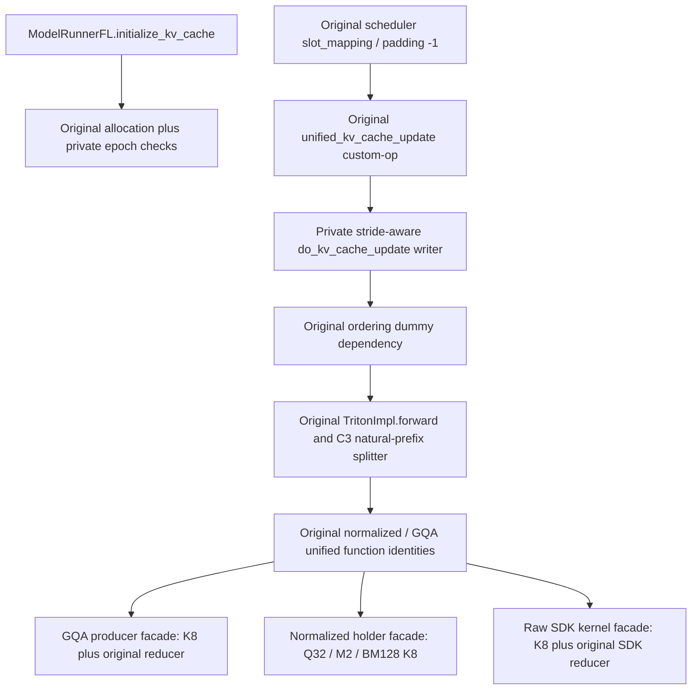

# Default-off private 16KiB encoded-cache service candidate

Base: authenticated API main **dac1b8fb48e7983e48283032efeee9b592c5fbe5**. The first normal fetch attempt timed out at20s low-speed; API and the already present Git object matched DAC. Parent subsequently fetched DAC successfully. No upstream SDK/dependency upgrade. This own branch is an **experimental service binding**. The root-owned three-request smoke below passed recovered startup/request checks; model precision and performance remain unverified.

`VLLM_FL_BIV150_KONLY_ENCODED_SERVICE` defaults0. Off executes no hook import/binding/device work. On installs once in a cold worker before KV allocation/capture. The official serve CLI stays unchanged. Author performed no SSH/JIT/GPU/service work.

## Actual seams and format

The physical cache remains BF16-shaped NHD `[P,2,16,2,128]`, strides `(8192,4096,256,128,1)` in BF16 elements,16KiB/page. Kcode is I8 at0..4095, Kscale FP32 at4096..4223, reserved4224..8191 remains, V BF16 stays8192..16383. No capacity recovery and no PR88 compact layout. Tensor dtype cannot authenticate payload; a cold, explicit per-allocation registry owns the format.



The writer is called at the real `TritonAttentionImpl.do_kv_cache_update` seam (target triton_attn.py724–767), not again in forward. Original attention.py `unified_kv_cache_update` retains the dummy dependency consumed by attention; profiling with no layer slot mapping skips the writer as before. Source K is post-RoPE; private fused-RoPE/cache writing is disabled before compilation and any attempted unqualified fused writer raises.

The83 writer function is copied byte-for-byte, with the same RN32→RNE codec, actual source token strides and int64 slot/index arithmetic. Negative/padded slots short-circuit source loads. No per-token `.cpu()`/`.item()` or newly invented freshness check: source/slot ordering, valid unique physical slots and padding-1 come from the original scheduler/block table/custom-op/stream contract. Main runner4069–4141/4360 and actual block_table326–380 are the source anchors. These are inherited contracts, not newly proven arbitrary concurrent mutation safety.

The86 broker constructs zero-copy typed aliases, independently verifies storage identity/pointer/offset/span, and separates K byte strides `(16384,256,128,1)` from V BF16 `(8192,256,128,1)`. FP32 scale points at full **layer-page0**, not at the scale field; kernels add1024 FP32 elements themselves. Nonzero aligned layer offsets are represented explicitly. Source K/V cannot alias writable cache. Strong base ownership prevents address reuse; the same impl changing allocation/view is rejected. A fresh worker/prefix/capture lifetime is required for reallocation. Prefix lookup/reuse and whole-page zeroing remain original; format stays fixed for the allocation lifetime. KV connector/offload/speculative ownership and encoded copy/swap/layout conversions are refused pending separate qualification.

## Reader dispatch and original main stack

Top-level `attention.unified_attention`, its normalization/GQA closures and C3 builder/forward identities remain unchanged. Three **inner** kernel bindings get format-aware facades: main GQA producer, raw SDK kernel, and the existing normalized-holder entry. No encoded launch falls through to ordinary BF16 data interpretation. Untagged reads after the encoded epoch is armed, unknown aliases, mode/features/geometry/ABI mismatches and foreign IR refuse.

Existing main natural-prefix splitting remains installed, with original metadata/stream preparation. Since shape/dtype metadata stays BF16 and outer functions are unchanged, it can still issue prefix GQA and suffix prefill calls. **Actual service trace is pending**; source preservation alone is not a claim that every mixed batch splits. Facade events record profile/query rows/sequence count/hash so a63/31 decode prefix can be distinguished from all-sequence2D. Non-leading/interleaved mixed calls currently use one encoded all-sequence2D reader, including its decode rows: no second85 launch and no duplicate writes. Before formal throughput, actual trace must confirm leading-prefix GQA remains and assess restoring85 plus a disjoint prefill-skip-decode path for non-leading mixtures.

Reader sources come from frozen79/80/87 factories. Profile selection preserves Q32 BM256/BQ32/T64/w16/s1 for one large sequence, M2 same tile for two, normalized BM128/BQ16/T64/w8/s1 otherwise, and raw3D original SDK grid/segments/options/reducer. General grids are `qrows//BQ+num_seqs`, not fixed benchmark geometries. Q32 is explicitly **unhoisted I8 fragment**: no old exact-hash overlay is borrowed. Fresh service IR/ABI/resources must be collected before claiming a new hoist or component speedup. Source-generation proofs and component eager/Graph evidence do not qualify new service specializations.

The fixed source dependencies already have component implementation evidence:79 native-QK/codec/decode,83 strided writer,80 Q32,87 BM128 eager/changed-input Graph+side,80 M2 and raw q1/q2 exact cases,85 scattered mixed. Original BF16 proxy failures remain; none is represented as new service/model precision acceptance. The separate81 result102/105 is only old56 stock-cache pure-decode quantization. It cannot certify this encoded-prefill candidate.

## Identity and cache safety

Private GPU functions have independent JIT objects/caches. Installed SDK/helper/backend and main Q32/M2 chain identities are pinned before any mutation. New binding construction is atomic with rollback before any encoded write. The source bundle is generated by stdlib-only materialization, with exact factory inverse proofs; generated GPU modules are never imported by CPU checkers.

`compute_order` has an explicit enabled-only **dispatch receipt**. It verifies registered facade objects/underlying parents, writer/lifetime/transfer binding objects, private kernel identities, actual dispatch code identity, allocation tags and implementation digest. Only then are parent interfaces inspected by the original metadata-stack proof. Parent `.fn` reflection is **not** treated as proof of new KV math. Default-off proof takes the unchanged parent route. New numerical certification remains false.

`compile_semantics` includes the default-false feature bit and an enabled-only `konly_encoded` record with format and implementation SHA. That digest covers every private Python implementation plus the source manifest, agrees with install/selected logs and changes the compiled graph identity. Old BF16/old-format captures are not valid on-state evidence. It adds no keys to the original Torch ABI dictionary. The main worker tail uses explicit os import, preserves CRLF bytes and updates the sole runner pin. A complete exact reverse patch proves the three original files return to DAC bytes.

## Log protocol / next root action

- `BIV150_KONLY_ENCODED_INSTALL`: installed binding, format scope, implementation SHA, unhoisted/service-unverified status.
- `BIV150_COMPILE_SEMANTICS`: enabled `konly_encoded` format and matching implementation SHA.
- `BIV150_KONLY_ENCODED_SELECTED`: actual returned compiled hash (or honest null), source digest, profile, query rows and sequence count. These are host/capture events, never fabricated Graph replay counts.
- `biv150_konly_encoded_service.stats()`: writer/selected/fallback host counts, all observed hashes, claimed allocations and explicit precision/service/hoist limits.

The root-owned359 short-request smoke is recorded below. Further validation must capture fresh sources/typed ABI/IR/resources and actual compute-order selection where eligible; unknown resource values remain unknown. Startup/ABI failures are not numerical negatives. No full105/throughput is claimed. No author device entry is executed here.

```sh
PYTHONDONTWRITEBYTECODE=1 python3 -W error tools/materialize_biv150_konly_encoded.py
PYTHONDONTWRITEBYTECODE=1 python3 -W error tools/check_biv150_konly_encoded_cpu.py
```

The second command executes the actual new worker tail off/on without an os global, reverses the exact production patch, checks source-digest on/off separation, uses explicitly synthetic metadata/kernel recorders for routing and rejects aliases/reallocation/capture creation/transfer/feature mismatches. It does not simulate GPU math. All shape-wide service, lifecycle/Graph, model105, official throughput and TTFT gates remain open. Keep Draft.

## Final statistics export (separate instrumentation revision)

The new runtime wraps the actual `ModelRunnerFL.shutdown` and also registers an atexit fallback. It exports once, preserving the original shutdown return/error. With the existing absolute private `TRITON_CACHE_DIR`, the default output is its parent `konly-encoded-final-{pid}.json`; an explicit absolute `VLLM_FL_BIV150_KONLY_ENCODED_STATS_PATH` may contain the literal `{pid}`. No file is written per token. Export uses exclusive temporary creation plus atomic replace, refuses an existing final file, and reports failures without hiding model/shutdown results. Missing export is an evidence gap. Abrupt process termination can prevent Python shutdown/atexit; absence cannot be interpreted as zero activity.

The file records process PID/start tick, source implementation digest, all host counts and observed kernel hashes, per-shape grid/dtype/stride/offset/selected scalar/capture counts (bounded4096, explicit overflow), and actual returned CompiledKernel metadata/typed signature/constants/attrs/source digest/artifact SHA/resources when available. Unknown metadata/resources remain null or explicitly unrepresented; no Tensor repr/data read occurs. New-hash SELECTED events replace the former first-role-only event, so later compiled variants are visible. The complete shape table distinguishes differently sized launches sharing a compiled hash. These are host/capture observations and still **do not count kernel executions inside Graph replay**. No service numerical or hoist certificate is invented.

CPU tests exercise one-shot shutdown/atexit export, original return preservation, atomic files, shape records, missing-resource unknown status and no-repr serialization. Kernel/writer/codec source and the three original production files remain byte-identical to359 in this instrumentation revision. Its implementation/compile fingerprint changes because runtime source is included. The original359 smoke source/output are untouched.


## Existing359 three-request smoke, independently replayed

Root ran the original359 source with the fixed official service CLI on9031, FULL_DECODE_ONLY, GPU memory utilization0.85 and max model length131072. Owner639752/start345722213 completed three HTTP requests (prompt18/18/5137 tokens, each16 completion tokens). The real enabled compile fingerprint and implementation digest matched; all9 existing parent installers remained installed, including large_linear. Actual SELECTED hashes were recorded for writer83, normalized2d128 (capture256/256), decode (capture64/64), and q32 (2048/1). These host/capture events do not close every executed shape or count Graph replay executions; no actual mixed split or compute-order reorder is inferred.

The original external controller incorrectly searched for the writer label `writer` instead of the emitted `writer83`. Its failed state, traceback and logs are preserved unchanged. Root fixed that parser independently and recovered the existing smoke evidence without a GPU rerun. The archive contains all9 records-only raw files (91327 bytes), the separate recovered report, the original and two later controller sources, and the pinned stdlib helper. Generated caches are excluded explicitly; the original remote output is retained. CPU replay checks245 source hashes against Git359, the on/off fingerprint distinction, installer/selected events, response usage and owned cleanup. Native5c/v6 initial descriptors are checked; the remote after-run source/native/snapshot recheck is a **Root attestation plus proof SHA**, because its raw proof payload is not in this local records archive.

The deterministic39,693-byte tar has SHA256 `2fcf47081679219b1c2d4b87818ac026634eb2e8d391e8ac2007f5d5c160f97f`. Its member manifest and per-member SHA are under `docs/evidence/konly-encoded-service-20261027/smoke-records-v1/`; the separate CPU result is `smoke-replay-v1.json`. No database, model weights or generated compile caches are included. This is startup/short-request evidence only: **no Math105, precision, throughput or TTFT result**. The later4a770 final-statistics instrumentation has not been device-tested by this359 run.

```sh
PYTHONDONTWRITEBYTECODE=1 python3 -W error tools/check_biv150_encoded_smoke_evidence.py
```

The capture256/256 normalizedBM128 route differs from stock raw2D's compact decode geometry. It is format-aware, but its padding/work and high-N performance need measurement before throughput qualification. Current Q32 remains unhoisted. A new live-source/ABI proof is required for any later override; the old component overlay is not licensed by this smoke hash alone.


## Fresh service Q32 hoist adapter (independent opt-in revision)

`VLLM_FL_BIV150_KONLY_SERVICE_Q32_HOIST=0` is a second, default-off switch. It takes effect only with the existing encoded-service flag1. With it off, no hoist helper imports, preparation, warmup or override occurs. With it on, only the existing eager single-sequence Q32 profile is eligible. M2/raw3D/BM128/GQA policies, physical16KiB layout, writer/codec/GPU Python bodies and parent installers remain unchanged. This does not restore scattered mixed splitting or change capture256 BM128 geometry.

This adapter packages PR90 `e4dd64e453fbe1bdeba4d8b2a1b551167e9446c4`'s structural proposer and native auditor **byte-for-byte**, not the oldEF347 overlay. On first actual specialization, it obtains the actual selected JIT object's ASTSource signature/constants/attrs, fn.src SHA, target/options, actual TTGIR/LLVM/ASM/cubin and CPU geometry. It moves one independently discovered immutable I8 Q operand local_load, fresh-compiles that new override with the same tensors/kwargs/grid/options, requires source/complete typed ABI/TTIR unchanged, audits actual TTGIR/LLVM/ASM dominance/liveness/synchronization and initializes handles to record known positive registers/zero spills/shared<=65536. Unknown IR/ABI/resource preparation stays on the **same private unhoisted** reader before any launch; foreign reader/source/hook identities refuse. The only reader launch is outside the preparation catch; returned compiled/ASTSource/function/source/hash/ABI-object identities must match the admitted immutable private object, and exceptions never retry a reader.

The primary installed JIT source is SHA256 `66a168ae959e719186771e66815e807f1e449e66c5283ef596ec3eb0e35cb775` (43174 bytes). Its lines737–756 add debug/instrumentation/FlagPrism options, select the actual per-device binder, bind and call compute_cache_key before lookup. The adapter uses those exact installed functions and normalization order. It does not guess native pointer alignment or implement native_specialize_impl. Its key additionally binds tensor dtype/device/shape/strides and the complete grid, covering SME's geometry-dependent cold derivation at761. A cache hit must still reference the same authenticated unhoisted and override CompiledKernel objects. Thus changed addresses with unchanged actual native specialization do not trigger another cold audit; new specializations are warm-compiled and audited once. Unsupported options or private-cache replacement retain the unhoisted path. The exact decorated829-byte codec source slice separately matches d73af836…; that digest is not mislabelled as an independently installed codec file.

Private first-compile artifacts go under `TRITON_CACHE_DIR`'s parent `konly-q32-hoist/{pid}/{specialization-digest}/`: both full actual artifact sets/live source/typed snapshots, the fresh override and binding/proposal/native/resource report. Full artifact SHA/ABI/native snapshots run only during cold admission. Repeated after_launch calls inspect object/source/hash/ABI-dictionary identities, with no artifact rehash or deep snapshot. Foreign in-place modification of an admitted private compiler metadata object is excluded by the immutable private-object contract. There is no per-token file IO. `BIV150_KONLY_Q32_HOIST_PREPARED` records actual hashes/resources; prelaunch rejection logs `BIV150_KONLY_Q32_HOIST_PRELAUNCH_RETAIN`. Existing final stats include bindings, cold/hot host counts and actual selected hoisted hashes. The explicit hoist enable bit and new implementation digest enter compile_semantics, so enabling cannot reuse an off-state graph. The new complete DAC reverse patch is production-changes-v2.patch; original v1 evidence remains intact. CRLF is retained.

Root's separate PR90 selected359 reconstruction proves originalc0a523… exact TTGIR/LLVM and fresh597cf3… native mechanism. Root's subsequent e4 component has4reader/0encoder/two-pattern full-output bitwise and loaded-resource passes; sibling independently recomputed its complete packed cache/INT64QK/FP64 references and guards. This is bounded Q2048/prefix4096 component evidence only. **This new live service adapter, other shapes, Graph/side, model accuracy and throughput remain unvalidated.** Its binding files keep numerical/service/model/performance status false rather than transferring that limited component certificate to arbitrary specializations. Root will test the new frozen service source with unchanged official CLI/full-geometry warmup and score; no author device action occurred.

```sh
PYTHONDONTWRITEBYTECODE=1 python3 -W error tools/materialize_biv150_konly_encoded.py
PYTHONDONTWRITEBYTECODE=1 python3 -W error tools/check_biv150_konly_encoded_cpu.py
PYTHONDONTWRITEBYTECODE=1 python3 -W error tools/check_biv150_konly_encoded_hoist_cpu.py
```

The third command replays immutable PR90 actual compiler artifacts from its exact Git object/archive SHA aae141e1… and exercises mock-only cache/admission/resource/ABI faults, address-stable specialization reuse, and the actual single-launch facade tail's postlaunch refusal. No Torch/Triton/vllm import, JIT, GPU or frontend emulation is performed. It does not certify this adapter's live binding or timing overhead.
